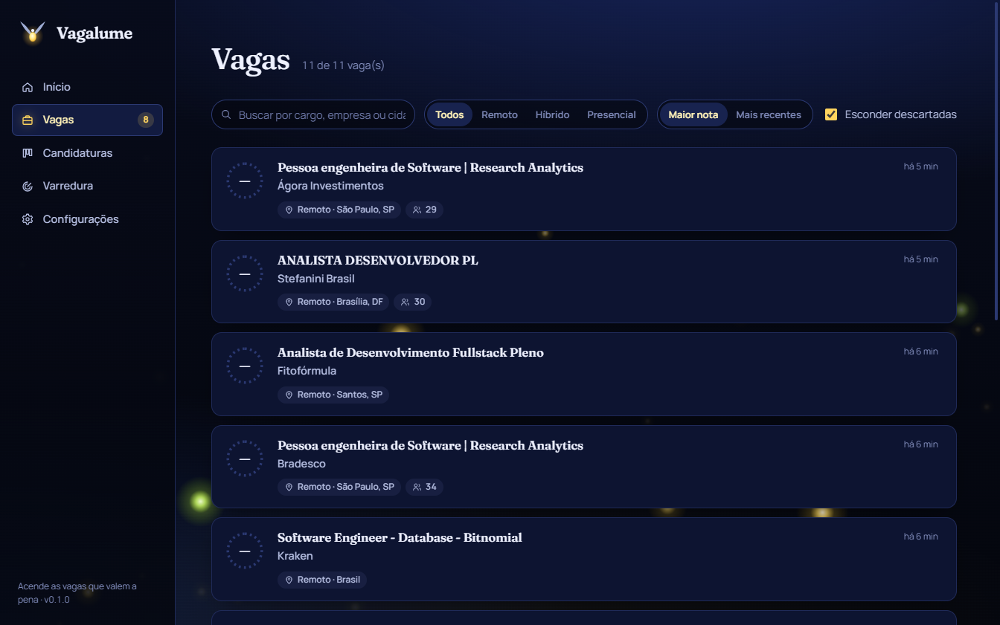
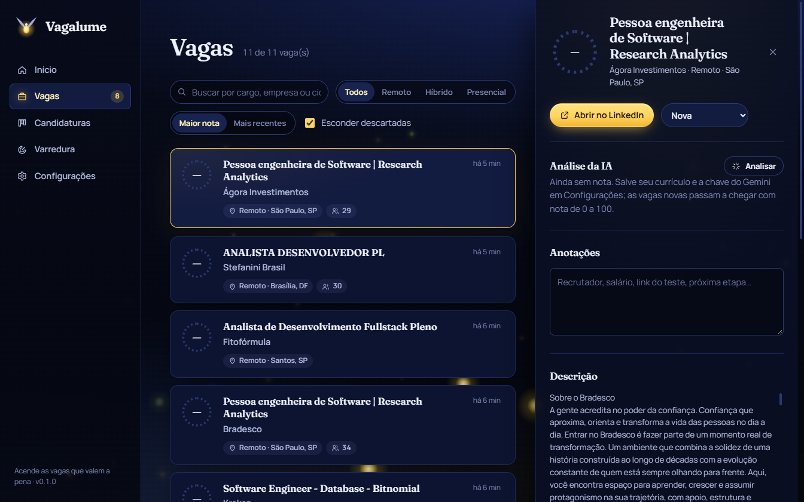
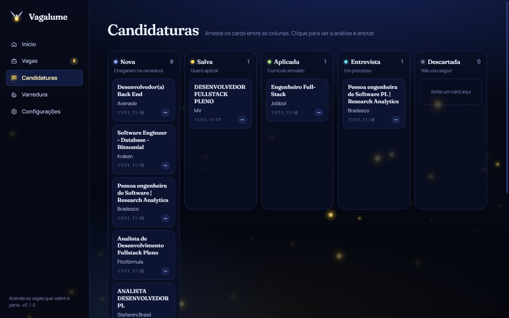
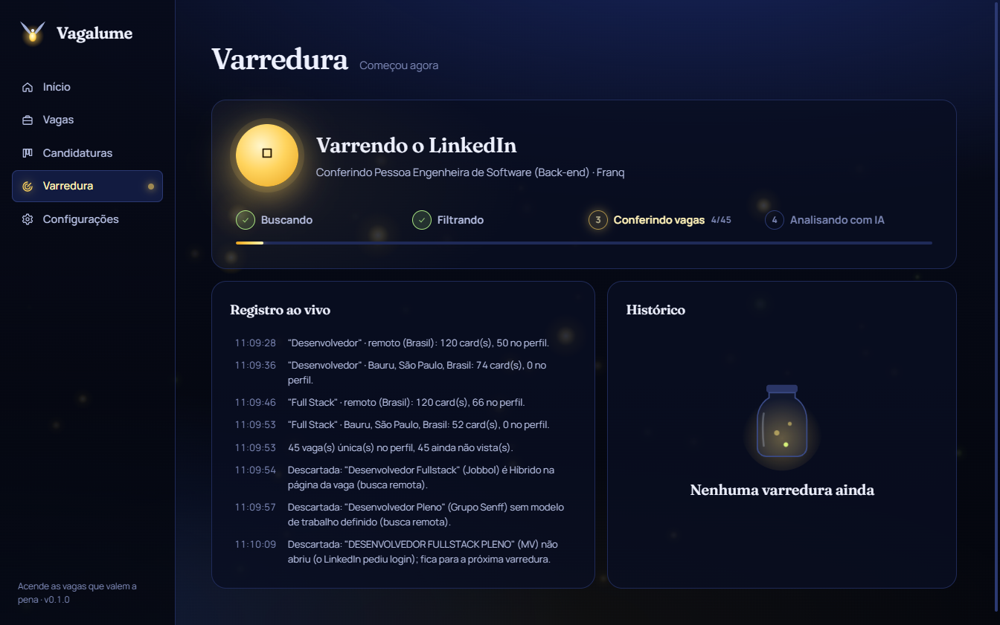
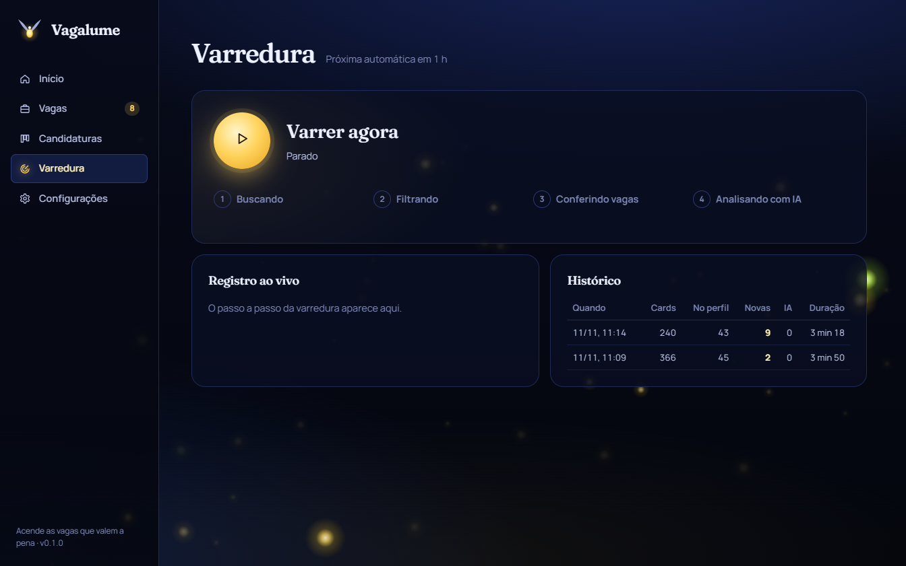
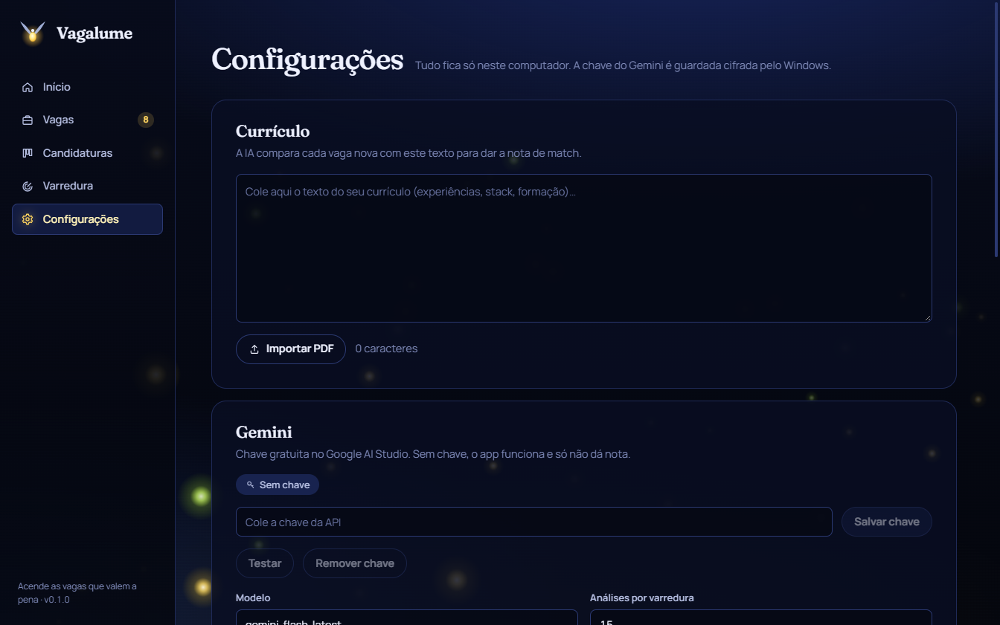

<div align="center">


# Vagalume

**Acende as vagas que valem a pena.**
App desktop para Windows que varre o LinkedIn, descarta o que foge do seu perfil, dá uma nota de match com o seu currículo e organiza suas candidaturas.


</div>

<p align="center"></p>

## O que ele faz

Procurar vaga no LinkedIn é rolar dezenas de anúncios promovidos, cargos sênior, stacks que você não usa e vagas com centenas de candidatos. O Vagalume faz a busca por você, com o app aberto ou na bandeja do Windows:

- **Busca filtrada** nas páginas públicas do LinkedIn: vagas **remotas no Brasil** e **presenciais/híbridas na sua cidade** (Bauru-SP por padrão), níveis 2 a 4 (`f_E=2,3,4`), publicadas nas últimas horas.
- **Sem promovidas, sem ruído**: exige termos de desenvolvimento no título e descarta senioridade alta, gestão, QA, dados/BI, DevOps, stacks fora do foco, mobile nativo, low-code e cargos "developer" que não são de software. Tudo editável na tela de Configurações.
- **Confere cada vaga**: abre a página da vaga para confirmar o modelo de trabalho, descartar promovidas e vagas acima do limite de candidatos, e guardar a descrição.
- **Anti-spam e sem repetição**: no máximo N vagas da mesma empresa em 24 h; vaga já vista nunca volta.
- **Nota de match com IA**: com o seu currículo (texto ou PDF) e uma chave do Gemini, cada vaga nova ganha nota de 0 a 100, pontos fortes, lacunas e um resumo de uma linha. Quanto maior a nota, mais o card brilha.
- **Kanban de candidaturas**: Nova → Salva → Aplicada → Entrevista → Descartada, arrastando os cards, com anotações e a data de cada mudança.
- **Varredura agendada**: a cada X minutos (padrão 60), com notificação do Windows quando aparece vaga com nota alta, e botão "Varrer agora" com progresso ao vivo.

## Telas

| Vagas | Detalhe da vaga (painel lateral) |
|---|---|
|  |  |

| Candidaturas | Varredura ao vivo |
|---|---|
|  |  |

| Histórico de varreduras | Configurações |
|---|---|
|  |  |

> Prints de uma varredura real (2 palavras-chave, janela de 24 h), ainda sem chave do Gemini: por isso as vagas aparecem sem nota e sem brilho. Com currículo e chave salvos, cada card ganha o anel com a nota e brilha proporcionalmente a ela.

## Como funciona uma varredura

```
palavras-chave × (remoto Brasil + cada cidade)
        │  Chrome/Edge do sistema, invisível, páginas públicas
        ▼
  Buscando ──► cards da busca ─► sem promovidas ─► título no perfil ─► sem termos de exclusão ─► cidade/modelo
        ▼
  Filtrando ─► junta repetidas ─► tira as já vistas
        ▼
  Conferindo ─► página de cada vaga: modelo real, promovida, nº de candidatos, descrição
        ▼                                   ─► anti-spam por empresa (24 h) ─► jobs.json (coluna "Nova")
  Analisando com IA ─► Gemini compara vaga × currículo ─► nota, pontos fortes, lacunas, resumo
        ▼
  notificação do Windows para nota ≥ mínima
```

## Rodar e gerar o instalador

Precisa de Node 22+ e do Google Chrome ou Microsoft Edge instalado (o Edge já vem no Windows).

```bash
git clone https://github.com/KevinLopes23/linkedin-job-bot.git
cd linkedin-job-bot
npm install
npm run dev        # abre o app em modo desenvolvimento
npm run dist       # gera release/Vagalume-Setup-<versão>.exe
```

Outros comandos: `npm test` (vitest), `npm run typecheck`, `npm run lint` (ESLint) e `npm run build`. As ferramentas de lint ficam em `tools/lint`, com TypeScript 6 próprio (o `typescript-eslint` ainda não roda com o TypeScript 7 do app); o `npm install` da raiz já as instala.

### Primeiro uso

1. **Configurações → Currículo**: cole o texto ou importe o PDF.
2. **Configurações → Gemini**: cole a chave gratuita do [Google AI Studio](https://aistudio.google.com/apikey) e clique em *Testar*. Sem chave o app funciona normalmente, só não dá nota.
3. **Varredura → Varrer agora**. Depois disso, ele varre sozinho no intervalo configurado. Fechar a janela só esconde o app na bandeja; para sair, use *Sair* no ícone da bandeja.

Os dados ficam só no seu computador, em `%APPDATA%\vagalume` (`settings.json`, `jobs.json`, `scans.json`). A chave do Gemini é guardada cifrada pelo Windows (DPAPI) em `secrets.json`.

## Estrutura

| Pasta | O que tem |
|---|---|
| `src/main/scan` | `filters.ts` (URLs e filtros do bot, puros), `parse.ts` (HTML da busca e da vaga), `linkedin.ts` (navegador), `scanService.ts` (etapas da varredura), `scheduler.ts` |
| `src/main/ai` | Cliente do Gemini com saída JSON validada (zod) |
| `src/main/data` | Validação (zod) e repositório de vagas/histórico |
| `src/main/store` | `JsonFile`: leitura validada e escrita atômica |
| `src/main/settings` | Configurações e chave cifrada |
| `src/main/ipc` | Handlers IPC com validação de toda entrada |
| `src/renderer` | React: Início, Vagas, Candidaturas, Varredura, Configurações |
| `build/` | Logo SVG e ícones (`render-icon.mjs` regera os PNG/ICO) |

## Aviso

O app lê as páginas públicas do LinkedIn, o que pode contrariar os Termos de Uso da plataforma. Use para fins pessoais, mantenha a pausa entre buscas e não sobrecarregue o site. Os seletores podem quebrar se o LinkedIn mudar o HTML.

## Autor

Feito por [Kevin Lopes](https://github.com/KevinLopes23)
